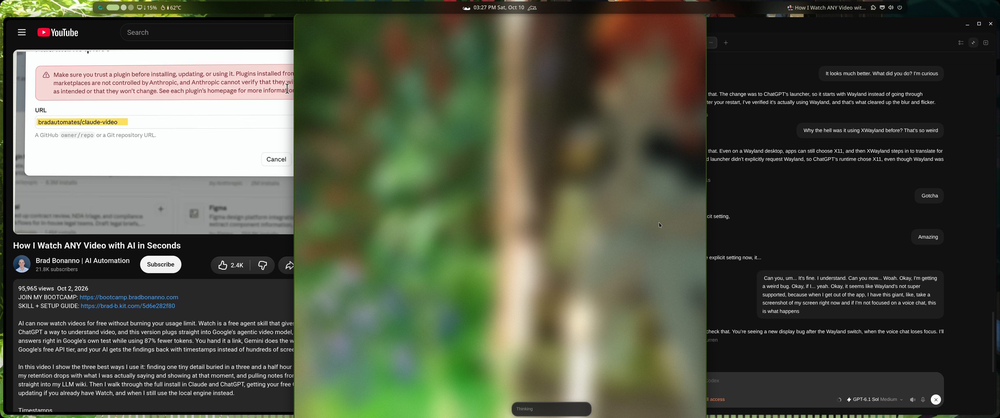
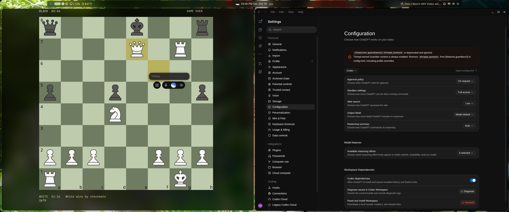
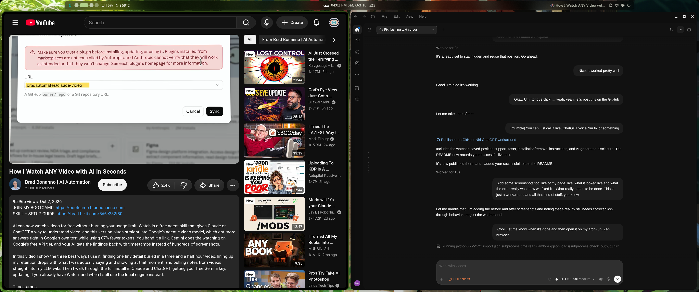
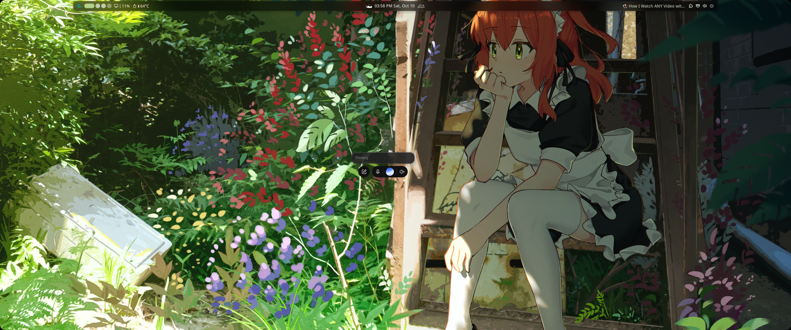

# What broke, what we tested, and what still needs fixing

## The observed problem

On this CachyOS/Niri desktop, switching away from ChatGPT during an active native Wayland voice call creates a floating helper. Its small voice controls sit inside a much larger transparent canvas. Niri reported a window around **1132 × 2273 logical pixels** on an output **2752 × 1152 logical pixels** at 125% scale.

Two things went wrong:

1. Desktop effects blurred the transparent canvas, exposing a huge panel over other windows.
2. Even after removing the visual effects, the canvas still intercepted clicks away from the visible voice controls.

The second problem was confirmed by clicking the chess window underneath it. Transparency alone did not make the surface click-through.

*Original failure: the helper's large canvas becomes a visible blurred panel. Its dimensions extend beyond the screen; only part of the surface is visible in this screenshot.*

## How to reproduce and check

1. Run ChatGPT's Linux preview natively on Wayland in Niri.
2. Start a voice call in the main ChatGPT window.
3. Focus a different app so the floating voice helper appears.
4. Try clicking another app both near and away from the helper's visible controls.
5. Return to ChatGPT and switch away again. The app can destroy and recreate the helper, so a one-time manual move is insufficient.

The effect varies with app version and compositor configuration. Blur is specific to the effects enabled on this desktop; input interception persisted without it. These screenshots document one observed setup, not every Niri installation.

## What we ruled out

| Attempt | Observed result |
|---|---|
| Disable blur, border, shadow, and related effects on the helper | Removed the giant visible panel, but clicks still did not reach the app underneath. |
| Force a compact size through window rules | Did not shrink the live helper. |
| Request a 320 × 160 size through Niri IPC | The app kept the 1132 × 2273 surface. Changing the outer geometry also would not necessarily scale the voice controls. |
| Use “Hide mini” during voice | The helper was recreated while the call remained active. |
| Close the helper | Ended the voice session, which defeats the goal. |
| Move the helper once to another workspace | Unblocked clicks and preserved voice, but a replacement helper appeared on the main workspace later. |
| Move the helper far off-screen | Niri clamped the position, retaining a visible corner. |

*Effects-only test: the giant blurred panel is gone, but the invisible surface still blocked clicks on the chess window. This image is an intermediate test, not the completed workaround. The configuration warning visible in ChatGPT is unrelated to the voice-helper problem.*

## What the workaround actually does

The watcher listens for Niri events and also checks periodically for delayed geometry changes. It identifies the oversized floating ChatGPT helper using app ID, title, geometry, and a separate main window from the same process. It then moves only that helper to the inactive `chatgpt-voice-hidden` workspace, without following focus.

This removes the blocking surface from the workspace where other apps are being used. It does not change that surface's input region. The helper and its voice controls still exist on the parking workspace.

Every move is revalidated immediately before execution and checked afterward. New helper IDs and a previously moved helper returning to the desktop are handled again. Optional saved coordinates position each newly parked helper on the hidden workspace. Manual dragging there is not continuously overridden.

*After parking: the main desktop and ChatGPT page are unobstructed. Niri metadata confirmed that the floating helper was on the inactive parking workspace when this screenshot was captured. Continuing voice and working clicks were checked separately.*

*The helper is still alive: visiting its workspace shows the small voice controls over the wallpaper. This demonstrates where it went; it was not closed. Visiting that workspace also exposes its original input behavior again.*

## What a real fix needs

The large canvas appears intentional for the mini/animation system. A large transparent window can work correctly if only the actual controls accept pointer input. Making the canvas smaller is not the only possible fix.

An upstream fix should make the native Wayland helper behave like this:

- Render non-content areas transparently without unintended compositor effects.
- Set and maintain an input region that covers only interactive controls, so clicks elsewhere reach the underlying app, including after helper recreation.
- Keep voice running when the user hides the floating helper, ideally through a supported persistent setting.
- Position the helper and its visible controls reliably on Wayland across display sizes and scales.

The exact responsibility for the input-region failure has not been isolated between this app build and Niri. The next diagnostic step is a minimal Wayland input-region reproduction on Niri, compared with a compositor where the same helper works. Verify whether the client sends the intended region, whether it is reapplied after recreation, and whether the compositor honors it. This repository contains no compositor patch or app patch and does not establish which component needs the eventual code change.

[The Linux voice-widget report](https://github.com/openai/codex/issues/50963) describes a similar click-blocking problem. [The oversized-window report](https://github.com/openai/codex/issues/48018) covers the large surface. [The Hyprland discussion](https://github.com/hyprwm/Hyprland/discussions/11834) concerns that compositor's handling of input regions; its patch cannot be applied directly to Niri.

## Remaining limitations

This remains a workaround: the window is created before the watcher can move it, so it can briefly appear or steal focus. Floating controls are unavailable on the main workspace. Detection depends on narrow geometry and identity heuristics that app updates can change. The named workspace affects workspace indices, and the saved position can need adjustment after display changes.

Live tests confirmed automatic parking across several helper replacements, re-parking a returned helper, and restoring saved coordinates after parking. The user confirmed the resulting placement worked well. Automated tests cover selection and guarded actions; they do not prove voice audio or input behavior. Login startup is configured but has not yet been tested through a fresh login.

The code and documentation were generated with OpenAI Codex, then checked through tests and local runtime observations. The screenshots are real captures of the user's desktop, not generated mockups. This project is independent of OpenAI and Niri.
